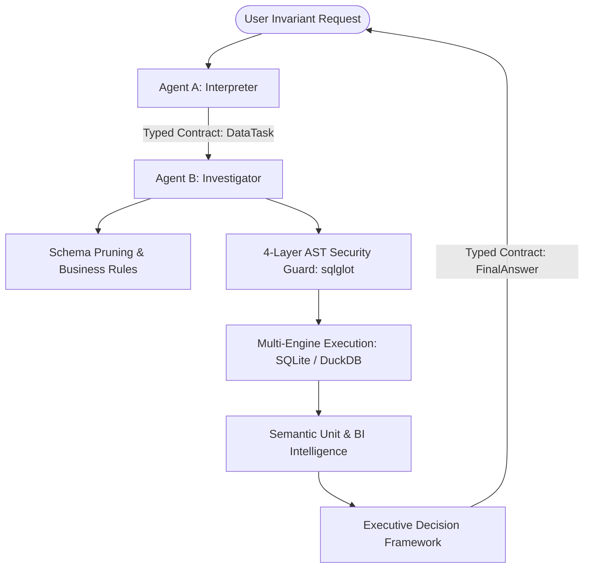

# 🛡️ Kratos — Operating Directives & Multi-Agent Architecture

Kratos is a sovereign, contract-driven, AST-governed multi-engine conversational data intelligence platform.

---

## 🔒 1. Core Invariants & Safety Mandates

1. **Strict Read-Only Enforcement (4-Layer Defense):**
   * **Never** execute or emit modifying SQL: `DROP`, `DELETE`, `UPDATE`, `INSERT`, `ALTER`, `TRUNCATE`, `GRANT`, `MERGE`, `COPY`, `VACUUM`.
   * Only `SELECT` (and `WITH ... SELECT`) statements are valid.
   * If a user requests data alteration, politely decline and provide read-only analytical observations.

2. **AST-Driven Validation (sqlglot):**
   * Regex-based SQL validation is strictly prohibited. All queries must pass through `kratos/security/sql_guard.py`.
   * Prohibited operations inside subqueries, CTEs, or inline views trigger immediate rejection.
   * Row-level lock directives (`FOR UPDATE`, `FOR SHARE`) and `SELECT ... INTO` are rejected.

3. **Runtime Fetch Bounding:**
   * Every query must be bounded by `LIMIT 500`. The engine cuts off fetch buffers to prevent host memory exhaustion.

4. **Deterministic Communication via Typed Contracts:**
   * Free-form conversation loops between agents are prohibited.
   * All inter-agent communication follows:
     $$\text{InterpretedRequest} \longrightarrow \text{DataTask} \longrightarrow \text{DataEvidence} \longrightarrow \text{FinalAnswer}$$

5. **Semantic Unit & Metric Integrity:**
   * Currency: `$ USD` with appropriate scale formatting (`$K`, `$M`, `$12.50`).
   * Percentages: `%` (e.g., `15.0%`).
   * Discrete Counts: `pedidos`, `órdenes`, `transacciones` — **NEVER** prefix with `$`.
   * Inventory & Physical Stock: `unidades`, `piezas`, `stock`, `uds` — **NEVER** prefix with `$`.
   * Transit & Time: `días`, `horas`, `minutos`.

---

## 👥 2. Specialized Two-Agent Ecosystem

| Agent Identifier | Operational Title | Mission & Boundary |
| :--- | :--- | :--- |
| `InterpreterAgent` | **User Interpreter & Executive Storyteller** | Classifies user intent (`Intent`), validates parameters, produces `DataTask`, and synthesizes `ExecutiveStorytelling`. Does **not** execute SQL. |
| `InvestigatorAgent` | **Schema Explorer & Safe Query Executor** | Consumes `DataTask`, applies `SchemaPruner`, queries LLM/heuristics, verifies AST via `sqlglot`, executes with read-only cursor, and auto-reflects on rejections up to 3 attempts. |

---

## 🗄️ 3. Supported Multi-Engine Database Contexts

* **`northwind`**: E-commerce, sales, orders, employee performance, categories, products.
* **`chinook`**: Digital media store, tracks, artists, albums, genres, customer invoices.
* **`sakila`**: Movie rental store, actors, films, categories, rental transactions.
* **`adventureworks_dw`**: Manufacturing & sales data warehouse, finance, products.
* **`tpch`**: Supply chain, part suppliers, orders, volume shipping benchmarks.

---

## 🚀 4. Harness² Recursive Optimization Substrate

Kratos integrates the **Google Research Harness²** substrate (arXiv:2610.14224):
* **Task-level recursion:** Refines execution harnesses via contrastive Propose-Probe-Compose steps.
* **Harnessing-level recursion:** Maintains persistent evidence-supported lessons to optimize system prompts and routing.
* Run benchmarks anytime via: `uv run kratos harness`.
