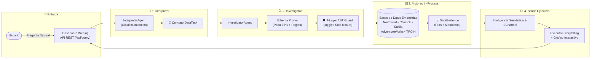

# 🛡️ Kratos — Sovereign Data Intelligence & Governance Platform

[](https://www.python.org/)
[](https://fastapi.tiangolo.com/)
[](https://github.com/tobymao/sqlglot)
[](https://echarts.apache.org/)
[](https://arxiv.org/abs/2610.14224)
[](LICENSE)

> **Plataforma soberana de inteligencia de datos conversacional multi-motor, gobernada por árboles de sintaxis abstracta (AST) y guiada por protocolos formales de contratos entre agentes.**

---

## ⚡ ¿Qué es Kratos?

**Kratos** transforma la forma en que los humanos interactúan con bases de datos analíticas mediante Inteligencia Artificial:

1. **Protocolo Formal de Contratos (`DataTask`):** Elimina las charlas libres y descontroladas entre agentes de IA. Toda comunicación sigue un contrato inmutable: `InterpretedRequest ➔ DataTask ➔ DataEvidence ➔ FinalAnswer`.
2. **Defensa Matemática en 4 Capas (AST con `sqlglot`):** Sin expresiones regulares vulnerables. Cada consulta SQL se descompone en su árbol de sintaxis abstracta, bloqueando mutaciones (`DROP`, `DELETE`, `UPDATE`), inyecciones en CTEs y consultas desbordadas (`LIMIT 500` forzoso).
3. **Inteligencia Semántica de Unidades de Negocio:** Diferenciación estricta de métricas (`$ USD`, `%`, `días`, `pedidos`, `unidades`), impidiendo la alucinación de cifras o confusión de unidades.
4. **Analítica Embebida de Alta Velocidad (*In-Process*):** Descubrimiento en caliente de bases de datos locales (DuckDB, SQLite) sin necesidad de contenedores de Docker ni servicios externos.

---

## 🗺️ Arquitectura del Sistema



> 📖 **Para una explicación detallada componente por componente con analogías del mundo real:**
> 👉 Consulta la [**Guía Exhaustiva de Arquitectura**](docs/ARQUITECTURA.md).

---

## 🚀 Inicio Rápido

### 1. Prerrequisitos
Kratos utiliza [`uv`](https://github.com/astral-sh/uv) para la gestión ultraveloz del entorno virtual y dependencias en Python:

```bash
# Instalar uv si no lo tienes
curl -LsSf https://astral.sh/uv/install.sh | sh
```

### 2. Levantar el Servidor Local
```bash
# Inicia el servidor nativo en su puerto dedicado (8888)
uv run uvicorn kratos.api.main:app --host 0.0.0.0 --port 8888 --reload

# O mediante la CLI integrada de Kratos:
uv run kratos serve --reload
```

* **Dashboard Analítico:** Abre [http://localhost:8888](http://localhost:8888)
* **Documentación Interactiva en Línea:** Abre [http://localhost:8888/documentation](http://localhost:8888/documentation)
* **Especificación Swagger API:** Abre [http://localhost:8888/docs](http://localhost:8888/docs)

---

## 🔬 Suite de Pruebas y Benchmark

```bash
# Ejecutar los 12 tests automatizados (AST Guard + Pipeline E2E)
uv run --extra dev pytest

# Ejecutar el sustrato recursivo Harness² (evaluación de los 8 componentes)
uv run kratos harness

# Ver información de motores analíticos y tablas activas
uv run kratos info
```

---

## 🗄️ Motores de Datos Preconfigurados

| Motor ID | Dominio de Negocio | Tablas | Archivo Local |
| :--- | :--- | :---: | :--- |
| **`northwind`** *(Activo)* | E-commerce, pedidos, productos y empleados | 11 | `data/northwind.db` |
| **`chinook`** | Tienda de música digital, álbumes, canciones y facturación | 11 | `data/chinook.db` |
| **`sakila`** | Videoclub, rentas de películas, categorías y actores | 16 | `data/sakila.db` |
| **`adventureworks_dw`** | Almacén de datos empresarial, finanzas y manufactura | 12 | `data/adventureworks_dw.db` |
| **`tpch`** | Benchmark analítico de logística, proveedores y envíos | 8 | `data/tpch.db` |

---

## 📚 Documentación Adicional

* 📘 [**Arquitectura Exhaustiva y Componentes Explicados**](docs/ARQUITECTURA.md)
* 📜 [**Contexto Histórico y Manifiesto de Evolución**](docs/CONTEXT.md)
* 🛡️ [**Directivas Operativas y Reglas de Agentes**](AGENTS.md)
