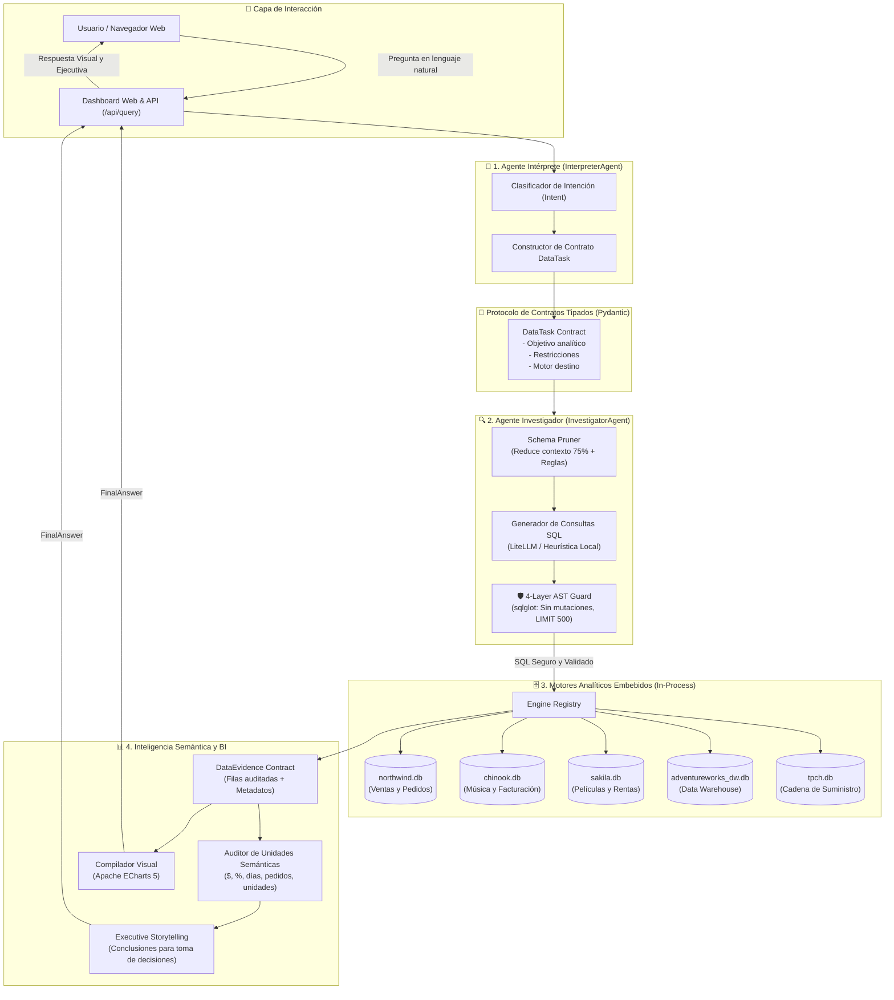
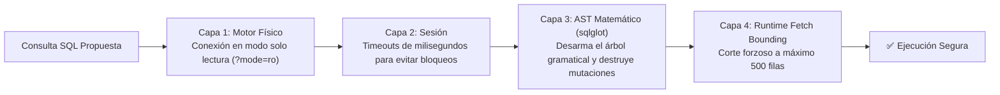
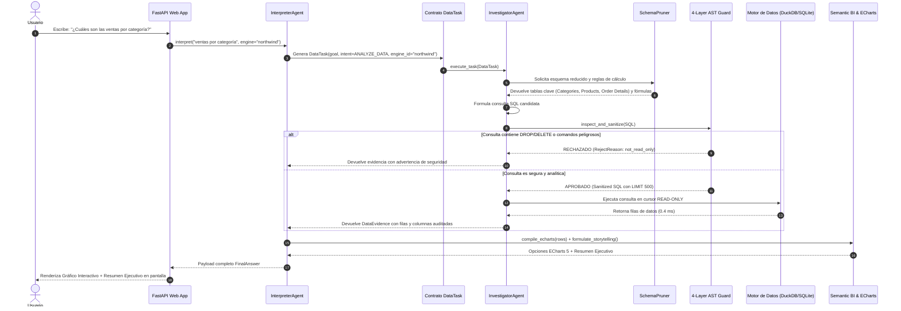

# 🛡️ Arquitectura del Sistema Kratos

> **Guía exhaustiva de arquitectura, componentes y flujo de datos de Kratos, explicada de forma clara, intuitiva y visual con diagramas renderizables en GitHub.**

---

## 🎯 1. ¿Qué es Kratos y qué problema resuelve?

Imagina que le pides a una Inteligencia Artificial tradicional:
> *"Dime cuánto vendimos el mes pasado y cuál fue el producto estrella."*

En un sistema convencional de IA, ocurren tres peligros graves:
1. **Peligro de Alucinación:** La IA inventa cifras o confunde unidades (dice "$500 dólares" cuando en realidad eran "500 cajas de producto").
2. **Peligro de Destrucción:** Si el usuario pregunta algo engañoso o malintencionado, la IA podría generar un comando destructivo (`DROP TABLE`, `DELETE`, etc.) y borrar la base de datos de la empresa.
3. **Peligro de Descontrol:** Los agentes de IA empiezan a "charlar" entre sí en texto libre sin un protocolo fijo, perdiendo el tiempo, consumiendo presupuesto de tokens y entrando en bucles infinitos.

**Kratos resuelve esto de raíz.** Es una plataforma de inteligencia de datos soberana que funciona como un **banco suizo**: no permite que la IA toque la base de datos libremente; todo pasa por contratos estrictos, un escudo de seguridad matemática en 4 capas y un sistema que garantiza que los números y las unidades sean 100% verídicos.

---

## 🏛️ 2. Analogía del Mundo Real: El Restaurante de Alta Cocina

Para entender Kratos sin tecnicismos complejos, imagínalo como un restaurante gourmet de máxima seguridad:

```
[Cliente Comensal] (Usuario)
       │
       ▼  "Quiero las ventas del año"
┌──────────────────────────────────────────────┐
│ 1. Capitán de Meseros (InterpreterAgent)     │
│    Escucha, entiende la intención y escribe  │
│    una comanda formal inmutable.             │
└──────────────────────┬───────────────────────┘
                       │ Comanda Formal (DataTask)
                       ▼
┌──────────────────────────────────────────────┐
│ 2. Chef Ejecutivo (InvestigatorAgent)        │
│    Recibe la comanda y planea la receta.     │
└──────────────────────┬───────────────────────┘
                       │
                       ├─► 3. Ayudante (SchemaPruner): Saca solo los 3 ingredientes
                       │                               necesarios, no toda la despensa.
                       │
                       ├─► 4. Inspector Bromatológico (4-Layer AST Guard):
                       │      Examina la receta. Si detecta veneno o peligro, la bloquea.
                       │
                       ├─► 5. Despensas de Alta Velocidad (DuckDB / SQLite):
                       │      Se extraen los datos en frío en modo solo lectura.
                       │
                       └─► 6. Balanza de Precisión (Semantic Unit Engine):
                              Verifica que los gramos no se confundan con dólares.
                       │
                       ▼ Hechos Auditados (DataEvidence)
┌──────────────────────────────────────────────┐
│ 7. Sommelier y Presentador (FinalAnswer)     │
│    Toma los datos, redacta el resumen        │
│    ejecutivo y monta el gráfico ECharts 5.   │
└──────────────────────┬───────────────────────┘
                       │
                       ▼ Plato Servido
[Cliente Comensal] (Respuesta Final con Gráfico y Conclusiones Claras)
```

---

## 🗺️ 3. Diagrama General de Arquitectura (Archify / Mermaid)

Este diagrama muestra cómo viaja la información a través de los componentes de Kratos:



---

## 🧩 4. Desglose Componente por Componente

A continuación explicamos cada pieza del sistema con palabras sencillas: qué hace, qué pasaría si no existiera y en qué archivo de código se encuentra.

---

### 1️⃣ El Agente Intérprete (`InterpreterAgent`)
* **Archivo:** [`kratos/agents/orchestrator.py`](file:///Users/roylee/Projects/kratos/kratos/agents/orchestrator.py)
* **¿Qué es en palabras sencillas?** Es el recepcionista inteligente. No sabe ni le interesa cómo buscar en la base de datos; su único trabajo es escuchar al usuario humano, comprender qué necesita y traducirlo a una orden formal estructurada.
* **¿Qué evita?** Evita que una pregunta ambigua ("¿cómo vamos?") cause caos. El intérprete la clasifica en intenciones precisas como `ANALYZE_DATA`, `QUERY_DATA` o `COMPARE_DATA`.

---

### 2️⃣ El Contrato Formal `DataTask`
* **Archivo:** [`kratos/contracts/schemas.py`](file:///Users/roylee/Projects/kratos/kratos/contracts/schemas.py)
* **¿Qué es en palabras sencillas?** Es una orden por escrito con casillas obligatorias hecha con Pydantic.
* **¿Por qué es vital?** En muchos proyectos de IA los agentes "hablan" en texto libre y se confunden entre sí. En Kratos, el Agente A no puede hablar con el Agente B con texto libre: debe llenar un formulario estricto con:
  1. El motor de base de datos a consultar.
  2. El objetivo exacto en una sola oración.
  3. Las restricciones numéricas y de negocio.

---

### 3️⃣ El Podador de Esquemas (`SchemaPruner`)
* **Archivo:** [`kratos/inference/schema_pruner.py`](file:///Users/roylee/Projects/kratos/kratos/inference/schema_pruner.py)
* **¿Qué es en palabras sencillas?** Es el archivista que solo saca los 2 o 3 expedientes relevantes en vez de tirar 50 carpetas sobre la mesa.
* **¿Cómo funciona?** Si una base de datos tiene 30 tablas, enviarle las 30 al modelo de IA saturaría su memoria y aumentaría los costos y errores. El podador analiza las palabras clave de la pregunta (ej. "clientes", "pedidos") y selecciona únicamente las tablas necesarias, **reduciendo el tamaño del contexto hasta en un 75%** e inyectando las fórmulas oficiales del negocio (ej. cómo calcular ventas netas con descuentos).

---

### 4️⃣ El Escudo de Seguridad en 4 Capas (`4-Layer AST Guard`)
* **Archivo:** [`kratos/security/sql_guard.py`](file:///Users/roylee/Projects/kratos/kratos/security/sql_guard.py)
* **¿Qué es en palabras sencillas?** Es el detector de metales y guardia de seguridad de la base de datos.
* **¿Por qué no usamos simples filtros de texto o Regex?** Porque los hackers pueden ocultar comandos destructivos usando trucos sintácticos (`WITH x AS (DELETE ...) SELECT * FROM x`).
* **Las 4 Capas de Blindaje:**



1. **Capa 1 (Conexión de Solo Lectura):** Las bases de datos se abren físicamente con la bandera de solo lectura. Incluso si alguien intentara escribir, el disco rechaza la operación.
2. **Capa 2 (Límites de Sesión):** Control de tiempo estricto. Si una consulta tarda demasiado, se aborta para no congelar la máquina.
3. **Capa 3 (Árbol Sintáctico AST con `sqlglot`):** La consulta se desarma como un rompecabezas lógico. Si contiene cualquier pieza prohibida (`DROP`, `DELETE`, `UPDATE`, `ALTER`, `GRANT`, lectura de archivos del sistema operativo como `pg_read_file`), es rechazada instantáneamente.
4. **Capa 4 (Límite Forzoso de Filas):** Si la consulta olvidó poner un límite, el guardia inyecta `LIMIT 500` automáticamente para que ninguna consulta sature la memoria RAM del servidor.

---

### 5️⃣ Los Motores de Datos Embebidos (`EngineRegistry`)
* **Archivo:** [`kratos/engines/registry.py`](file:///Users/roylee/Projects/kratos/kratos/engines/registry.py)
* **¿Qué es en palabras sencillas?** La biblioteca de datos en disco.
* **¿Por qué DuckDB y SQLite?** 
  * No necesitan instalar un servidor pesado ni contenedores de Docker.
  * Los datos viven en archivos compactos dentro de la carpeta `./data/` (`northwind.db`, `chinook.db`, `sakila.db`, etc.).
  * El sistema los descubre y registra automáticamente al encenderse.
  * La velocidad de consulta es instantánea (de 0.3 a 5 milisegundos).

---

### 6️⃣ El Auditor de Unidades y Negocio (`Semantic Unit Intelligence`)
* **Archivos:** [`kratos/semantics/unit_utils.py`](file:///Users/roylee/Projects/kratos/kratos/semantics/unit_utils.py) y [`kratos/semantics/bi_engine.py`](file:///Users/roylee/Projects/kratos/kratos/semantics/bi_engine.py)
* **¿Qué es en palabras sencillas?** El inspector que vigila que no se confundan peras con manzanas.
* **¿Qué reglas vigila?**
  * **Dinero:** Si la columna dice `total`, `precio`, `sales`, o `monto`, le asigna el formato `$ USD`.
  * **Cantidades discretas:** Si son `pedidos`, `órdenes` o `transacciones`, **PROHIBIDO** ponerle `$`.
  * **Inventario:** Si es `stock` o `unidades`, se formatea como `unidades`.
  * **Tiempo:** Si es `duración` o `lead_time`, se mide en `días`.
  * **Porcentajes:** Si es `descuento` o `margen`, se formatea como `%`.

---

### 7️⃣ El Narrador Ejecutivo (`ExecutiveStorytelling`)
* **Archivo:** [`kratos/contracts/schemas.py`](file:///Users/roylee/Projects/kratos/kratos/contracts/schemas.py)
* **¿Qué es en palabras sencillas?** El analista sénior que traduce una tabla aburrida de 200 filas a un mensaje claro para el director general.
* **¿Qué produce?**
  1. **Conclusión principal:** Una sola frase contundente con la cifra clave y su unidad.
  2. **Hallazgos numéricos:** Los datos auditados más relevantes.
  3. **Recomendaciones estratégicas:** Acciones sugeridas de negocio basadas en los números.

---

### 8️⃣ El Generador Automático de Gráficos (Apache ECharts 5)
* **Archivo:** [`kratos/semantics/bi_engine.py`](file:///Users/roylee/Projects/kratos/kratos/semantics/bi_engine.py)
* **¿Qué es en palabras sencillas?** El diseñador visual del sistema.
* **¿Cómo decide qué gráfico pintar?**
  * Si la consulta tiene fechas o tiempo (`mes`, `año`, `fecha`), genera automáticamente un **gráfico de líneas**.
  * Si tiene 6 elementos o menos y una sola métrica, genera un elegante **gráfico de dona/pastel**.
  * Si compara categorías o productos, genera un **gráfico de barras moderno**.
  * Ajusta colores oscuros de alta legibilidad, tooltips interactivos y nombres de ejes con las unidades correctas.

---

### 9️⃣ El Sustrato de Pruebas Continuas (`Harness²`)
* **Archivo:** [`kratos/harness/agent.py`](file:///Users/roylee/Projects/kratos/kratos/harness/agent.py)
* **¿Qué es en palabras sencillas?** El simulador de pruebas de vuelo que audita a Kratos antes del despegue.
* **Inspirado en:** Google Research (*Harness²*, arXiv:2610.14224).
* **¿Qué hace?** Corre una batería de pruebas automatizadas contra todos los motores de base de datos verificando que el 100% de las consultas respondan de forma segura y en menos de 100 milisegundos. Se puede ejecutar en cualquier momento con:
  ```bash
  uv run kratos harness
  ```

---

## 🔄 5. Flujo Secuencial de una Consulta Paso a Paso

El siguiente diagrama de secuencia ilustra el viaje exacto desde que el usuario escribe en la pantalla hasta que ve su gráfico:



---

## 📂 6. Mapa de Archivos del Proyecto

```
kratos/
├── kratos/                     # Paquete principal Python
│   ├── agents/                 # Orquestación de Agentes
│   │   └── orchestrator.py     # InterpreterAgent e InvestigatorAgent
│   ├── contracts/              # Protocolo de comunicación inmutable
│   │   └── schemas.py          # Modelos Pydantic (DataTask, DataEvidence, FinalAnswer)
│   ├── security/               # Escudo de seguridad matemática
│   │   └── sql_guard.py        # 4-Layer AST Guard con sqlglot
│   ├── semantics/              # Inteligencia de unidades y BI
│   │   ├── unit_utils.py       # Detección y formato de unidades ($, %, pedidos, uds)
│   │   └── bi_engine.py        # Generador de configuraciones ECharts 5
│   ├── engines/                # Motores de datos embebidos
│   │   └── registry.py         # Descubrimiento en caliente de bases de datos
│   ├── inference/              # Poda de contexto e inferencia soberana
│   │   ├── schema_pruner.py    # Reducción de contexto del 75% y reglas de cálculo
│   │   └── client.py           # Cliente soberano LiteLLM / Fallback heurístico
│   ├── harness/                # Laboratorio de evaluación continua
│   │   └── agent.py            # Sustrato recursivo Harness² (Google Research)
│   ├── api/                    # Servidor web y API REST
│   │   └── main.py             # Rutas FastAPI, endpoints y Dashboard interactivo
│   └── cli.py                  # Interfaz de línea de comandos (`uv run kratos`)
├── data/                       # Bases de datos analíticas embebidas
│   ├── northwind.db            # E-commerce, pedidos, productos y empleados
│   ├── chinook.db              # Tienda de música digital, canciones y facturas
│   ├── sakila.db               # Rentas de películas, categorías y actores
│   ├── adventureworks_dw.db    # Almacén de datos empresarial y finanzas
│   └── tpch.db                 # Benchmark de logística y proveedores
├── tests/                      # Suite de pruebas unitarias y de integración
│   ├── test_guard.py           # 6 pruebas del escudo de seguridad AST
│   └── test_pipeline.py        # 6 pruebas de integración extremo a extremo
├── docs/                       # Documentación técnica
│   ├── CONTEXT.md              # Génesis y manifiesto de evolución
│   └── ARQUITECTURA.md         # Esta guía de arquitectura exhaustiva
└── pyproject.toml              # Definición de dependencias y empaquetado uv
```

---

## 🚀 7. Resumen de Comandos Clave

| Acción | Comando | Descripción |
| :--- | :--- | :--- |
| **Levantar la aplicación local** | `uv run kratos serve --reload` | Inicia el dashboard en el puerto soberano `http://localhost:8888` |
| **Ver la documentación en línea** | Abrir `http://localhost:8888/documentation` | Página visual interactiva con diagramas Mermaid |
| **Correr las pruebas automatizadas** | `uv run --extra dev pytest` | Ejecuta los 12 tests unitarios y de integración |
| **Ejecutar el benchmark Harness²** | `uv run kratos harness` | Evalúa los 8 componentes de arnés con 6 tareas reales |
| **Inspección de bases de datos** | `uv run kratos info` | Lista los motores activos y número de tablas |
